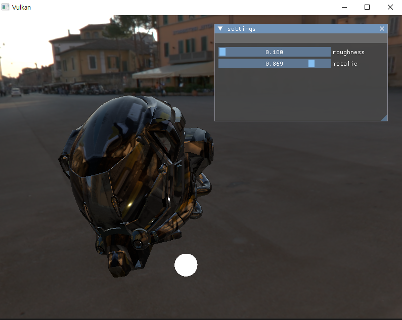

# VulkanRenderer
- vulkan api를 사용한 미니 렌더러입니다.

# 세팅
## 필수 환경

- Windows 10/11 (64-bit)
- Visual Studio 2022 (C++ 데스크톱 개발 워크로드, MSVC 및 Windows SDK 포함)
- [Vulkan SDK](https://vulkan.lunarg.com/sdk/home) 설치 및 `VULKAN_SDK` 환경 변수 설정
- [CMake](https://cmake.org/download/) (`Visual Studio 17 2022` 생성기 지원 버전, PATH 등록 필요)

설치 후에는 터미널이나 VS Code를 다시 열어 환경 변수 변경을 반영하세요.

---

## Windows 빌드 및 실행 

저장소 루트의 [`BuildAndRun.bat`](./BuildAndRun.bat)을 더블클릭하세요.

```powershell
.\BuildAndRun.bat
```
---


# Feature

- Instancing
- PBR-IBL
- Mouse-Picking
- Deferred-rendering (using subpass)
- Omnidirectional-shadowMapping
- KTX(Khronos Texture) texture storage Format을 사용하였습니다.
- gtlf 2.0 format with tinygltf [tinygltf](https://github.com/syoyo/tinygltf).

# InProgress
- GPUT based Culling and LOD
- SSAO


# 조작법
- 마우스로 회전 및 wasd키로 이동 및 마우스휠로 줌인 줌아웃.
- 헬멧을 클릭하여 회전을 할 수 있습니다

---

# Android 빌드 및 실행

## 요구 사항

| 항목 | 버전 |
|---|---|
| Android Studio | Hedgehog (2023.1.1) 이상 |
| Android NDK | r25c 이상 |
| CMake | 3.22.1 이상 |
| 대상 기기 | Android 7.0 (API 24) 이상, **Vulkan 1.0 지원 필수** |
| 아키텍처 | arm64-v8a |

> Vulkan 지원 여부 확인: [Vulkan Caps Viewer](https://play.google.com/store/apps/details?id=de.saschawillems.vulkancapsviewer) 앱으로 확인

---

## 1단계 — 저장소 클론

```bash
git clone https://github.com/<your-username>/VulkanRenderer.git
cd VulkanRenderer
```

---

## 2단계 — Android Studio에서 열기

1. Android Studio 실행
2. **File → Open** 선택
3. 클론한 폴더 안의 **`android/`** 폴더를 선택하여 열기
   (`VulkanRenderer/android/` — `build.gradle`이 있는 폴더)

---

## 3단계 — NDK & CMake 설치

Android Studio 상단 메뉴:

```
Tools → SDK Manager → SDK Tools 탭
```

아래 항목을 체크하고 **Apply**:

- [x] **NDK (Side by side)** — r25c 이상
- [x] **CMake** — 3.22.1 이상

---

## 4단계 — 기기 연결 및 개발자 모드 활성화

1. 핸드폰 **설정 → 휴대전화 정보 → 빌드 번호** 를 7번 탭 → 개발자 모드 활성화
2. **설정 → 개발자 옵션 → USB 디버깅** 켜기
3. USB 케이블로 PC와 연결
4. 핸드폰에서 **"USB 디버깅 허용"** 팝업 → 허용

Android Studio 상단 기기 선택 드롭다운에 연결된 기기가 표시되면 준비 완료.

---

## 5단계 — 빌드 & 설치

Android Studio 상단의 **Run** 버튼 클릭 (또는 `Shift + F10`)

> 첫 빌드 시 Gradle이 CMake로 C++ 소스를 컴파일하므로 **5~10분** 소요될 수 있습니다.

---

## Android 조작법

| 제스처 | 동작 |
|---|---|
| 오른쪽 손가락 드래그 | 카메라 회전 |
| 왼쪽 손가락 드래그 | 카메라 이동 (전후좌우) |
| 두 손가락 핀치 | 줌 인/아웃 |

---

## 트러블슈팅

**`local.properties` 파일이 없다는 에러**
Android Studio가 자동으로 생성합니다. 직접 지정하려면 `android/local.properties` 파일을 만들고 아래 내용을 추가하세요:
```
sdk.dir=C\:\\Users\\<사용자명>\\AppData\\Local\\Android\\Sdk   # Windows
sdk.dir=/Users/<사용자명>/Library/Android/sdk                   # macOS
```

**NDK를 찾을 수 없다는 에러**
`Tools → SDK Manager → SDK Tools`에서 NDK 설치 여부 확인

**기기가 인식되지 않음**
USB 드라이버 재설치 또는 케이블 교체, USB 디버깅 재확인

**앱 설치 후 즉시 크래시**
기기가 Vulkan을 지원하지 않을 수 있습니다. Vulkan Caps Viewer로 지원 여부 확인

